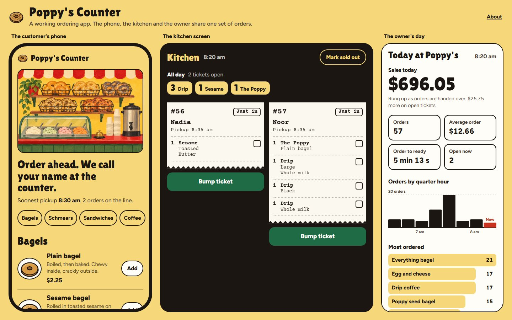
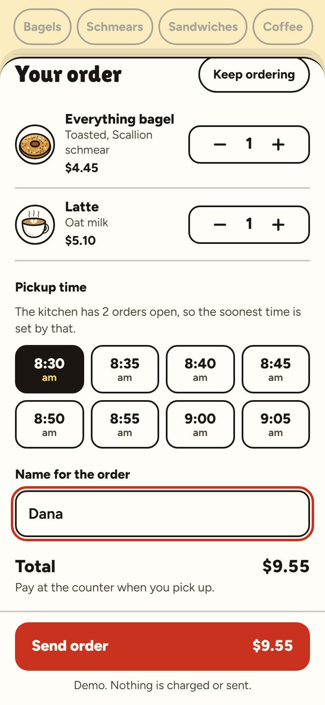

# Poppy's Counter

A bagel shop's ordering app: phone, kitchen and owner, always in step.

**[Try it](https://michaelshadpour.com/try/poppys-counter)** | [Write-up](https://michaelshadpour.com/work/poppys-counter)





## What it is

Poppy's Counter is a working ordering app for a fictional neighborhood bagel shop. A customer builds an order on the phone and picks a pickup time offered from the kitchen's real load. The ticket prints in the kitchen, where cooks bump items, watch the all-day counts and mark things sold out. The owner's day (sales, orders by quarter hour, best sellers, order-to-ready time) moves as it happens. On a wide screen the three stand side by side, so an order visibly travels from one to the next.

What to try: send an order, then switch to the kitchen. It is a working demo. Poppy's Counter is a fictional shop and nothing is charged.

- **Menu (the customer's phone).** Bagels, schmears, sandwiches, coffee. An item opens to its choices (toasted, a schmear, extras, size, milk) with the price rolling as you choose. The cart has quantities, pickup slots, a name, and Send order with "Demo. Nothing is charged or sent." under it. After sending, the order's state (Received, Being made, Ready) updates live, with how many orders are ahead.
- **Kitchen.** New tickets print: a printer head lands on the ticket's spot and the paper feeds out of it line by line, then tears. On a wide screen the order first flies from the phone to the printer. Tickets show their age and turn amber at 5 minutes and red with "Late" at 8. Tap a line to bump it, or press Bump ticket. A bumped ticket gets a Ready stamp, and Recall undoes the last bump. Mark sold out and Bring back work from one list.
- **Owner's day.** Sales (rung up as orders are handed over, since customers pay at the counter), orders, average order, order to ready, open and late tickets, orders by quarter hour with the current one in red, most ordered, and sold out. Two buttons: Send a rush of orders, and Start the day over.
- **Phone layout.** One view at a time with a Menu, Kitchen, Owner switcher. After the first order, the confirmation offers "See it print in the kitchen" and the Kitchen tab carries a dot until visited. From 1260 px wide (and at least 540 px tall) the three views sit side by side.
- **Self-running demo mode.** Open the page with `?attract=1`. An order is built item by item through the real buttons (a fingertip ring shows each tap), sent, and printed in the kitchen. One item and then the ticket are bumped, and the sales figure rolls up. A wide screen shows all three views at once. A tall screen goes from the menu to the kitchen to the owner's figure. Each loop starts from the same frozen morning at the same shop time. Any pointer, key or wheel input hands over a fresh live day.

Awkward cases it handles:

- An item sells out while it sits in a cart: the line is flagged, the order cannot be sent until it is removed, and the item sheet says so if it is open. A sold-out schmear or bagel also closes that choice on every item that uses it, and a sandwich closes when every bagel it can be on is gone.
- An empty cart has no cart bar, and the cart sheet explains what to do.
- A very long name is collapsed and capped at 40 characters, and wraps on the ticket.
- Twenty open tickets: the rail scrolls, the all-day count wraps, and pickup slots move later.
- The clock passes the chosen slot: it is refused and replaced by the next real slot.

## How it works

- **One append-only event log, everything else derived.** There are eight event types (day opened, order placed, item bumped, order ready, order recalled, item sold out, item back, rush started). The menu's availability, the kitchen's tickets and all-day counts, the customer's order status, the pickup slots and every owner figure are pure functions of the folded log and the time. Every reducer rule is idempotent and the fold sorts and de-duplicates by event id, so the same events in any order give the same state (a unit test shuffles them 25 ways).
- **Tabs stay in step without a server.** The log lives in `sessionStorage` (a reload keeps the day) and is shared over `BroadcastChannel`: a new tab asks for the log and adopts the open day, every tab merges by event id, and starting the day over replaces it everywhere. An end-to-end test opens two tabs, marks an item sold out in one and watches the other gray it out, then bumps an order from the second tab and sees the first tab's customer screen say Ready.
- **A seeded morning rush with simulated cooks.** The morning before the visitor arrives (6:30 to 8:20 on the shop's own clock, 57 orders) and the "Send a rush of orders" button are generated from a seed: triangular arrivals, weighted orders, and three cooks working tickets first come first served with realistic prep times. The generated events are never stored. Each tab replays them from the seed up to the current time with stable ids, so tabs agree and a reload replays exactly. Rush orders that hit a sold-out item drop it, or are turned away and counted. A unit test runs 12 seeds and checks that each morning is busy but coping (1 to 5 tickets open on arrival, none late, average order to ready between 2 and 10 minutes, rail clear within 20 minutes).
- **Pickup slots from real load, money in cents.** The earliest slot is the cooking left on every open ticket shared between the cooks, plus a few minutes, on five-minute marks. A slot with four orders promised is full, and there is nothing after 2 pm. If the clock passes the chosen slot while the cart is open, it moves to the next one and says so. Prices, totals, sales and averages are integer cents end to end, and line prices are fixed into the order when it is sent.
- **The shop's own clock, and when a sale counts.** The shop keeps its own clock that always starts at 8:20 in the morning, so the demo is in the breakfast trade whatever the visitor's time of day. Sales count when an order is ready rather than when it is placed, because the demo shop takes payment at the counter. Open tickets show as "more on open tickets". This also makes the owner's figure move right after the bump, so the order reads phone, then kitchen, then owner.
- **Measured during development.** First load was about 240 KB transferred (29.4 KB JS and 6.4 KB CSS gzipped, 79 KB of fonts, the 124 KB shop picture). Over one loop of the self-running demo at 1440 x 900 in headless Chromium: 618 frames, mean 16.7 ms, worst 16.8 ms. At 390 x 844 with 4x CPU throttling: mean 19.2 ms, p95 and p99 16.8 ms, with one long frame per run that varied between runs (667 ms in the latest, 1.4 s once, 150 ms in two others, at the loop reset), most likely because the development machine was busy.
- **Design.** A neighborhood bagel counter drawn rather than photographed. A butter yellow page, ink type, poppy red for the actions that send or add, and one deep green for ready. Amber marks tickets that are waiting, and tickets have a thermal paper tone, so age reads at a glance and the ticket looks like a ticket. Every menu item has an illustration drawn in SVG in one sign painter's hand: one outline weight, flat color, one highlight per object, and seeded seed scatters so a bagel always looks the same (plain, sesame, poppy, everything, cinnamon raisin). Schmears are heaped deli tubs banded in their flavor color, sandwiches are drawn in layers, and there are three cups. The top of the menu carries the shop's one picture, a painted view of the counter (baskets of bagels, the schmear case, the coffee urn, the striped awning) whose butter yellow, poppy red and green the rest of the app shares. The kitchen is the one dark surface, like a real kitchen screen, so the paper tickets stand out. The printed ticket is the only place a typewriter face appears.

### Known limits

- Sync is per browser: tabs of one browser follow each other, two devices do not. There is no server, by design.
- Two tabs that each start a fresh day at the same moment settle on one of them. A day with orders in it is never replaced by another tab's fresh day, only by Start the day over.
- Cross-browser checks ran in Chromium only.
- Frame times were measured in headless Chromium with software rendering, not on a real phone.
- The kitchen has no sound for a new ticket. Sound would need a tap first and a mute control, and was left out to keep the demo quiet.
- The owner's chart starts at 6:30 and grows one bar per quarter hour while the page stays open. After 2 pm no pickup slots are offered and the menu says the kitchen is closed. Start the day over brings it back to 8:20.
- During development the end-to-end suite failed one assertion in 1 of 9 runs after the shop picture was added. The failing test was not captured. The wait in the self-running demo test was raised from 15 to 25 seconds as the likeliest cause.

## Stack

Vite 8, TypeScript (strict), Preact 11 with `@preact/signals`. No backend, no runtime network requests, no service worker. Vitest for unit tests and Playwright (Chromium) for end-to-end tests.

## Run it

```
npm install
npm run dev          # http://localhost:5316
npm test             # Vitest: the unit tests in tests/unit/
npm run typecheck    # tsc --noEmit
npm run build        # type check, then production build in dist/, relative paths
```

End-to-end tests:

```
npx playwright install chromium
npm run test:e2e     # builds, then runs Playwright against dist/
```

- `npm test` runs Vitest, which `vite.config.ts` limits to `tests/unit/**/*.test.ts`: 51 unit tests for the reducers, the derived views, pricing, the cart, the pickup slots, the rush's determinism, and the opening rush across 12 seeds.
- `npm run test:e2e` builds the app, then Playwright starts `scripts/serve.mjs` and runs `tests/e2e/` against the build served at `http://127.0.0.1:5416/dist/`. There are two Playwright projects: a touch phone at 390 x 844 and a desktop at 1440 x 900. The file holds 6 end-to-end tests, 3 written for the phone and 3 for the desktop, and each is skipped in the other project.
- `node scripts/checks.mjs` is an extra check to run after `npm run build`, with Chromium installed as above. It opens the build on a 360 px phone, a landscape phone and a tablet, at 1280 px and 1920 px wide, with reduced motion and inside an iframe, and fails on console errors, failed requests or sideways scrolling. It also prints frame times over one loop of the self-running demo. Its screenshots go to `shots/checks/`, which Git ignores.

The dev server uses port 5316. The end-to-end tests and the checks script serve the build on port 5416. Both have to be free.

## Layout

- `src/domain/`: the event types, the reducer and fold, the derived views (menu availability, kitchen tickets, order status, pickup slots, owner figures), pricing, the cart, the seeded rush and the shop clock. Pure functions, no DOM code.
- `src/store.ts`: the event log, saved in `sessionStorage` and shared between tabs over `BroadcastChannel`.
- `src/ui/`: the Preact views (menu, kitchen, owner), the sheets, the rolling figures and the self-running demo mode.
- `src/art/`: the menu illustrations and the mark, drawn in code, and the shop picture.
- `tests/unit/` and `tests/e2e/`: the Vitest unit tests and the Playwright end-to-end tests.
- `scripts/`: the static server the end-to-end tests use, and the extra checks.
- `docs/`: the screenshots in this README.

## Credits and license

- Lilita One by Juan Montoreano, SIL Open Font License 1.1, `@fontsource/lilita-one` (latin, 400). Wordmark, headings, big figures.
- Figtree by Erik Kennedy, SIL Open Font License 1.1, `@fontsource-variable/figtree` (latin and latin-ext, weight axis). Everything else.
- Courier Prime by Alan Dague-Greene, SIL Open Font License 1.1, `@fontsource/courier-prime` (latin, 400 and 700). Kitchen tickets only.
- The shop illustration was generated with ChatGPT for this project. It is used once, at the top of the customer's menu, as `src/art/shop.webp` (1200 x 800, 124 KB).
- Everything else (menu illustrations, the mark, the favicon, the printer, the chart) is drawn in code.
- Concept project. Poppy's Counter is a fictional brand. Nothing is charged or sent.
- Design and build: [Michael Shadpour](https://michaelshadpour.com).
- The code is under the MIT license. See [LICENSE](LICENSE).
